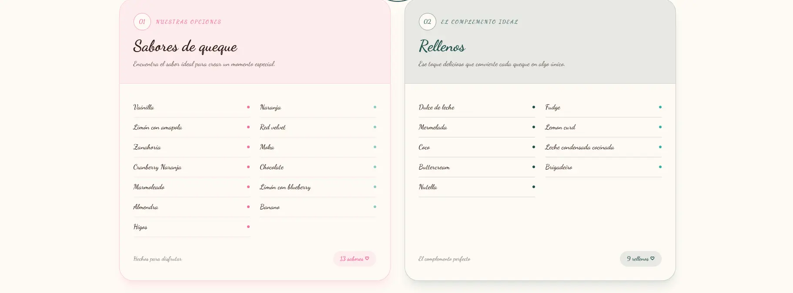

<div align="center">

# La mordida divina

**Artisan bakery website · Portfolio project**

[Live demo](https://carlosandrescl.github.io/la-mordida-divina/) · [Español](README.md) · **English**

[](https://github.com/CarlosAndresCL/la-mordida-divina/actions/workflows/ci.yml)
[](https://github.com/CarlosAndresCL/la-mordida-divina/actions/workflows/deploy.yml)


</div>

---

## Screenshots

### Home


### Flavors



### Contact and map


## About the project

**La mordida divina** is a portfolio project inspired by a real bakery in Guadalupe, San José, Costa Rica. I built it with the knowledge and authorization of the business, which allowed me to use its photos and logo for this purpose only.

It is a showcase website (frontend only, no backend) designed to present the products, the flavors and the location of the business, and to let a customer message it on WhatsApp or visit its Instagram in a single click.

> This site is **not the official website** of the business. For real inquiries or orders, its official channel is its Instagram: [@lamordidadivina](https://www.instagram.com/lamordidadivina/).

## Features

- Four pages: Home, About Us, Flavors and Contact, with navigation without page reloads thanks to React Router.
- Hero section with an image carousel that changes every 7 seconds.
- Loading screen with the logo, shown only once per session.
- Gallery linking to the business's Instagram: a hover overlay on desktop and a single button on mobile.
- Floating WhatsApp button with a prefilled message.
- Embedded Google Maps and a button that opens the route in the phone's maps app.
- Responsive design for mobile, tablet and desktop.
- Images optimized in WebP format.
- Alternative text on images, `aria-label` attributes on social links and semantic HTML.

## Tech stack

| Area | Tools |
| --- | --- |
| UI | React 19, React Router 7 |
| Styling | Tailwind CSS 4 (custom theme with `@theme`), Dancing Script and Quicksand fonts |
| Icons | react-icons, lucide-react, Flaticon UIcons |
| Bundler | Vite 8 |
| Maps | Google Maps (embedded map) |
| Code quality | oxlint, Prettier, Husky, lint-staged |
| Automation | GitHub Actions, GitHub Pages |

## Code quality and automation

The project has an automated workflow to keep the code tidy and working:

| Tool | What it does |
| --- | --- |
| **oxlint** | Checks the code for errors and bad practices (`npm run lint`). |
| **Prettier** | Applies a consistent format to every file (`npm run format`). |
| **Husky + lint-staged** | Before each commit, formats and checks only the files being committed. |
| **GitHub Actions (CI)** | On every push it runs a clean install, lint, format check and build. |
| **GitHub Actions (deployment)** | When `main` is updated, it builds the site and publishes it to GitHub Pages. |

## Running it locally

Requirements: [Node.js](https://nodejs.org/) (the project was developed with version 24) and Git.

```bash
git clone https://github.com/CarlosAndresCL/la-mordida-divina.git
cd la-mordida-divina/LaMordidaDivina
npm install
npm run dev
```

Then open the address shown in the terminal (usually `http://localhost:5173/`).

| Command | What it does |
| --- | --- |
| `npm run dev` | Starts the development server. |
| `npm run build` | Generates the production build in the `dist` folder. |
| `npm run preview` | Shows a local preview of the build. |
| `npm run lint` | Checks the code with oxlint. |
| `npm run format` | Formats all files with Prettier. |
| `npm run format:check` | Checks the format without changing anything. |

To test the site as it is published on GitHub Pages, which uses a different base path:

```bash
npm run build -- --base=/la-mordida-divina/
npm run preview
```

## Repository structure

Simplified structure:

```text
la-mordida-divina/
├── .github/
│   └── workflows/
│       ├── ci.yml            # lint, format and build on every push
│       └── deploy.yml        # publishing to GitHub Pages
├── docs/
│   └── screenshots/          # screenshots used in this README
├── LaMordidaDivina/          # the project (npm commands run here)
│   ├── .husky/               # pre-commit hook
│   ├── public/
│   ├── src/
│   │   ├── assets/           # WebP images
│   │   ├── components/       # components grouped by section
│   │   ├── layouts/          # shared structure (navigation, footer, loader)
│   │   ├── pages/            # home, about us, flavors and contact
│   │   └── styles/
│   ├── index.html
│   └── package.json
├── LICENSE
├── README.md
└── README.en.md
```

## Deployment

The site is published on **GitHub Pages** through a GitHub Actions workflow (`deploy.yml`). Because the site lives in a subfolder (`/la-mordida-divina/`), the process:

1. Builds the project with that base path.
2. Copies `index.html` as `404.html`, so internal routes (for example `/sabores`) keep working when the page is reloaded, since GitHub Pages does not support redirect rules.
3. Publishes the result.

This repository is the publishing version of the project; development was done in a separate private repository.

## What I learned

This is **my first project with React** (frontend development) and **my first project published on GitHub**. Besides building the site, I learned several things I did not know how to do when I started:

- **React and React Router:** functional components, hooks (`useState`, `useEffect`) and navigation between pages without reloading, organizing components by section.
- **Tailwind CSS:** utility classes, responsive variants (`sm:`, `md:`, `lg:`), states such as `hover` and `group-hover`, and a custom theme with colors and fonts.
- **Git and GitHub:** branches, clear commit messages, pull requests and publishing a repository while protecting privacy (anonymous email in commits).
- **Code formatting with Prettier:** what a formatter is, how to configure it and how to automate it so the style stays consistent without thinking about it.
- **Image performance:** I converted the photos to WebP and resized them; the weight of the images went from about 20 MB to under 2 MB, and loading improved noticeably.
- **Automation:** setting up Git hooks and a continuous integration and deployment workflow with GitHub Actions.

### What was hardest for me

- Setting up the tools on Windows: Git was not recognized in the terminal, the Husky hook failed because `bash` was missing, and line endings (CRLF and LF) caused errors.
- YAML indentation in GitHub Actions and `package-lock.json` sync errors during the automated install.
- Making the site look good on mobile: the hero oval, the footer wave and the map.
- Publishing on GitHub Pages: the base path, the router and the routes when reloading.

## Future ideas

- Contact form.
- Catalog with more product detail.
- Accessibility review and SEO improvements.
- Convert the remaining PNG images to WebP.
- Custom domain.

## License and credits

- **Code:** [MIT License](LICENSE).
- **Images, logo and the name "La mordida divina":** © La mordida divina. They are used with the business's authorization, only for this portfolio project, and are **not covered by the MIT license**: they may not be reused without its permission.

## Author

**Carlos Andrés Calderón Leiva**

- LinkedIn: [calderonleivacarlosandres](https://www.linkedin.com/in/calderonleivacarlosandres)
- GitHub: [CarlosAndresCL](https://github.com/CarlosAndresCL)
- Email: [ccal30454@gmail.com](mailto:ccal30454@gmail.com)
